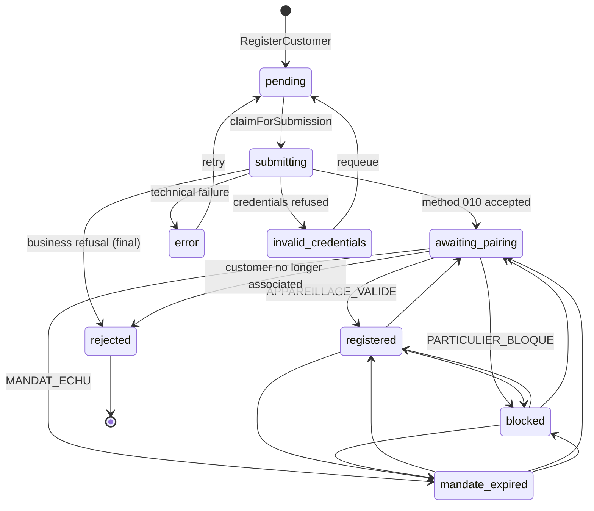
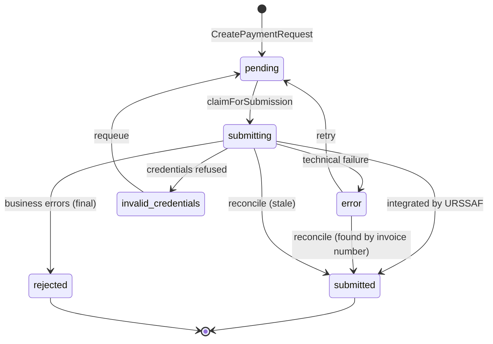
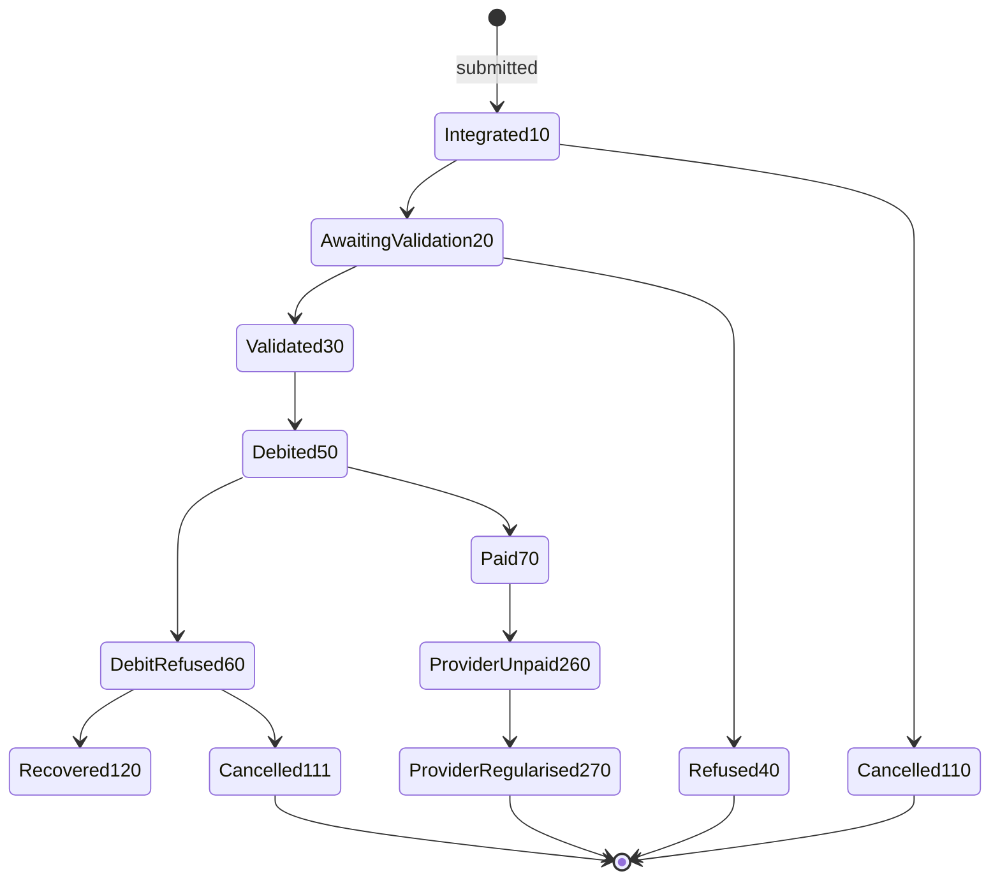

# Workflow

Two aggregates carry the workflow: `CustomerRegistration` (state: `Domain\Customer\RegistrationState`) and
`PaymentRequest` (local state: `Domain\PaymentRequest\SubmissionState`, plus the URSSAF status
`Domain\PaymentRequest\PaymentRequestStatus`). Every transition is explicit; an invalid one throws
`Domain\Exception\InvalidStateTransition`. Aggregates record domain events (`releaseEvents()`), which `UnitOfWork`
publishes after the transaction commit.

## Customer registration



`awaiting_pairing`, `registered`, `blocked` and `mandate_expired` follow the method 020 status
(`Domain\Customer\PairingStatus`) and may move to one another (or to themselves when the status is confirmed), and
to `rejected` when the customer is no longer associated with the provider.

| Method 020 status | Resulting state |
|---|---|
| `APPAREILLAGE_VALIDE` | `registered` |
| `APPAREILLAGE_EC`, `APPAREILLAGE_NF` | `awaiting_pairing` |
| `PARTICULIER_BLOQUE` | `blocked` |
| `MANDAT_ECHU` | `mandate_expired` |

Only a `registered` customer can receive payment requests (`ensureCanReceivePaymentRequests()`), and the employment
period of an invoice must not start before the pairing was accepted.

## Payment request

Local transmission state (`SubmissionState`):



Once `submitted`, the request follows the URSSAF status (`PaymentRequestStatus`, backed by the official code):



The diagram shows the usual paths only (see [api-reference.md](api-reference.md) section 3.3 for the meaning of each
code); the package does not enforce an order between URSSAF statuses, it records what URSSAF reports
(`applyUrssafStatus()`), keeps the history and the raw code.

- Final statuses (never polled again): `40`, `110`, `111`, `112`, `113`, `270`.
- Settled statuses (`70` paid, `120` recovered): money reached the provider but the status may still move, so the
  request is still polled until `settled_max_age` after the last status change.
- Method 050 may answer with an error code (for example `ERR_CMPT_BLOQUE`) in place of a status: the raw value is
  always kept (`rawUrssafStatus()`); `PaymentRequestStatus::fromCode()` returns `null` for it.

## Idempotency

- `RegisterCustomer` with the same tenant and external reference and the same customer details returns the existing
  registration id, whatever its state. Different details => `CustomerAlreadyRegistered`.
- `CreatePaymentRequest` with the same invoice number and the same external reference returns the existing id. Another
  external reference for an existing invoice number => `DuplicateInvoiceNumber`. URSSAF itself answers
  `ERR_FACTURE_DOUBLON` for a duplicate invoice.
- Submission use cases `claimForSubmission` first (atomic `pending` => `submitting`); an item that is not pending is
  reported `not_claimed`, so running a command twice, or concurrent workers, never sends a record twice.
- Unique constraints: registrations `(tenant, external reference)` and `(tenant, URSSAF customer id)`; payment
  requests `(tenant, invoice number)` and `(tenant, external reference)`.

## Retry and reconciliation

- Temporary failures (`RetryableException`: HTTP 429/500/503, transport error, local rate limit): requests that
  provably never reached URSSAF go `error` then back to `pending`, and `RetryableUrssafFailure` is thrown (carrying the
  retry-after delay when known). Messenger retries the message; with the commands, the next cron run retries.
- A batch that may have reached URSSAF (transport error without an HTTP status, HTTP 5xx on method 050) stays
  `submitting`. It is **never resent blindly** (URSSAF would answer `ERR_FACTURE_DOUBLON`): it is first looked up at
  URSSAF by the reconciliation below.
- Stale submissions (`submitting` for at least `stale_submission_after`, `PT15M` by default): `ReconcileStaleSubmissions`
  searches them by invoice number with method 070 (10 per call, per tenant). The reconciliation itself never sends a
  payment request: found => `submitted` with the URSSAF id and status (`reconciled`); proven absent at URSSAF (the search
  answered without them) => `error` then `pending` again (`requeued`), so that the next submit run sends them as new
  requests; search failed => left `submitting`, nothing is assumed.
- Stale registrations (`submitting` for at least `stale_submission_after`): URSSAF offers no way to find a registration
  from the customer data (method 020 needs the URSSAF customer id, which only the lost method 010 answer carried), and
  sending it again would be refused as already registered if the first call succeeded. `ReconcileStaleRegistrations`
  (command `urssaf:customers:reconcile-stale`) therefore never guesses: each such registration is moved to `error` with
  the cause `urssaf.submission_outcome_unknown` (outcome `manual_review`) and is **not** retried automatically. An operator checks
  the customer in the URSSAF provider space and, once sure that it was not registered, retries it.
- Submission attempts are counted (each `pending` -> `submitting`). After `max_submission_attempts` (5 by default) a
  technical failure is no longer requeued: the record stays in `error` (`exhausted`) for a manual action. The errors of
  the last failure are kept through a retry, and every failure records `CustomerRegistrationFailed` /
  `PaymentRequestSubmissionFailed`.
- A refusal of the credentials (`UrssafAuthenticationFailed`) puts the records in `invalid_credentials` and returns a
  report (no exception). After fixing the credentials, `RequeueAfterInvalidCredentials` (command
  `urssaf:requeue-invalid-credentials --tenant=...`) moves them back to `pending`; repeat while the counts reach the limit.
- A business rejection (`rejected`) is final: fix the data and create a new registration or payment request.
- Unknown pairing status codes are left untouched (`unknown_status`); `ERR_RECHERCHE_PARTICULIER` on method 020 means
  the customer has no active registration with the provider any more: the registration becomes `rejected`.

## Events, outbox pattern and safety crons

Domain events are published by `UnitOfWork` **after** the package transaction commits, in the order they were
recorded. Consequences to design for:

- **Nested transaction.** When a handler is called inside a transaction of your application, the package transaction is
  a nested one (savepoint): the events are published when it returns, *before* your outer transaction commits. A
  listener that acts outside the database (sends a Messenger message to another process, calls an API) can therefore
  run before the data is visible, or run for a transaction that is rolled back afterwards. Either call the handlers
  outside your own transaction, or use the outbox pattern.
- **Publisher failure.** A listener that throws after the commit must not undo the work: the failure is isolated (the
  handler still returns normally; the data is committed). An event whose listener failed is lost for that listener.
- **Outbox pattern (recommended for anything that must not be lost).** Do not perform the side effect in the listener:
  have it insert a row (event type, payload, aggregate id) in an *outbox* table of your own database, in the transaction
  that is active when the event is published; a worker (cron or Messenger consumer) then reads the outbox, performs the
  side effect and marks the row as done. With a dedicated entity manager (see [doctrine.md](doctrine.md)), write the
  outbox through your own connection, not through the package one.
- **Safety crons.** Whatever the transport, make the workflow converge on its own: `messenger.auto_submit` only
  dispatches a message when the event is published; if the message is lost (broker down, publisher failure, crash between
  commit and publish) the record stays `pending` until something submits it. Keep these crons running even with
  `auto_submit` (they are idempotent and claim-protected, and cheap when there is nothing to do):

  ```cron
  */5  * * * *  php bin/console urssaf:customers:submit-pending              # pending registrations
  */5  * * * *  php bin/console urssaf:payment-requests:submit-pending       # pending payment requests
  */10 * * * *  php bin/console urssaf:customers:sync-pairing                # pairing follow-up
  */15 * * * *  php bin/console urssaf:payment-requests:sync-statuses        # status follow-up
  */15 * * * *  php bin/console urssaf:customers:reconcile-stale             # registrations left submitting
  */15 * * * *  php bin/console urssaf:payment-requests:reconcile-stale      # payment requests left submitting
  ```

- **No overlap.** Overlapping runs (a slow cron racing the next one, a cron racing a Messenger worker) are prevented per
  command and tenant by an optional Symfony Lock, see [symfony.md](symfony.md#locks-against-overlapping-runs). The
  atomic claims remain the last line of defence against a double submission.

## Polling policy

- Pairing (method 020): registrations in `awaiting_pairing`, then `blocked`, then `mandate_expired`, oldest update
  first. Registered customers are not polled: a blocked account is reported by method 050 (`ERR_CMPT_BLOQUE`).
- Payment request statuses (method 070): `submitted` requests whose status is not final, least recently polled first, in
  pages of `default_page_size` (max `max_page_size`), as long as the request is inside its polling window: a settled
  (paid / recovered) status stops being followed `settled_max_age` after it was observed (default `P90D`), a status code
  unknown to this package version `unknown_status_max_age` after it was observed (default `P30D`), and any request
  `max_polling_age` after its submission (default `P1Y`).
- Stale submissions: older than `stale_submission_after` (default `PT15M`).
- Submission: batches of `batch_size` (1 to 10) per method 050 call.
- Respect the URSSAF quotas (see api-reference section 1.1): enable `rate_limiter.enabled` and schedule the polling
  commands at a reasonable frequency (for example every 15 minutes).
- These values belong to `Application\Policy\WorkflowPolicy` (all optional constructor arguments) and, with Symfony, to
  the `workflow` configuration node.
